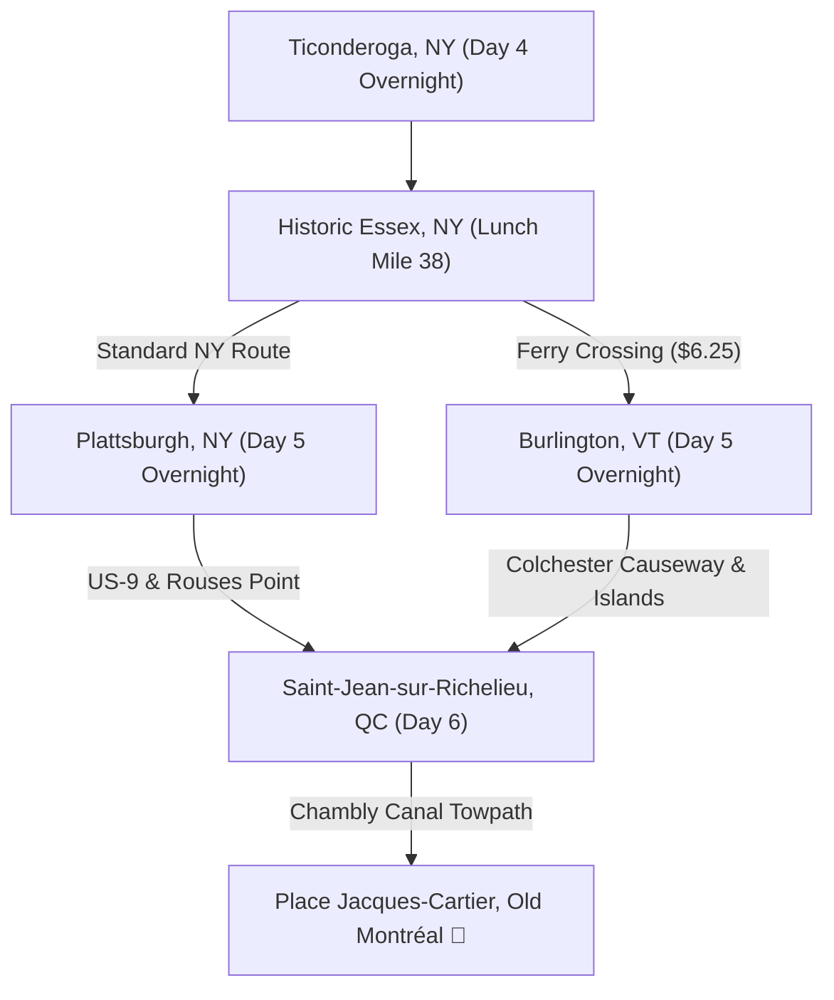

# NYC to Montréal: Vermont Champlain Islands Upgrade Variant
**The Premier Scenic Route: Essex Ferry, Burlington Greenway, Colchester Causeway & Champlain Islands**

*Widely celebrated as the most spectacular cycling in the entire American Northeast. Replaces the hilly NY Adirondack coastline with a ferry cruise to Vermont, a night in vibrant Burlington, and miles of car-free riding on a historic marble railway causeway extending into the open waters of Lake Champlain.*

---

## Executive Summary & Route Overview

| Metric | New York Baseline Route (Plattsburgh) | Vermont Upgrade Variant (Burlington & Islands) |
|:---|:---|:---|
| **Divergence Point** | Historic Essex, NY (Day 5) | Historic Essex, NY (Day 5) &rarr; Ferry to Charlotte, VT |
| **Day 5 Finish** | Plattsburgh, NY (~70 mi • +4,000 ft) | **Burlington, VT (~53 mi • +2,200 ft)** |
| **Day 6 Finish** | Saint-Jean-sur-Richelieu or Montréal (~87 mi) | **Saint-Jean-sur-Richelieu (~58 mi) or Montréal (~95 mi)** |
| **Water Crossing** | None (Shoreline bluffs) | **Lake Champlain Ferry (20 min) + Local Motion Bike Ferry** |
| **Signature Highlight** | Ausable Chasm & Lake Champlain Bluffs | **3-mile Colchester Causeway into open lake + Church St Marketplace** |
| **Scenic Ranking** | ★★★★☆ | ★★★★★ *(Unanimous cyclist favorite)* |

---

## Why Choose the Vermont Upgrade?

1. **The Charlotte–Essex Ferry (Day 5):** Instead of grinding up and down heavy highway hills into Plattsburgh, you roll onto a historic open-deck ferry in Essex, NY. The 20-minute crossing offers breathtaking 360° panoramas of the Adirondack High Peaks to the west and the Green Mountains to the east.
2. **Burlington Overnight (Day 5):** Burlington is one of America's premier cycling cities. Stay at *Hotel Vermont*, pedal the waterfront bike path, sample fresh artisan pizzas at *American Flatbread*, and watch the sunset over Lake Champlain with fresh local craft sours at *Foam Brewers*.
3. **The Colchester Causeway (Island Line Trail):** Ride 3 miles directly into the open waters of Lake Champlain along a historic 1900 marble railway embankment. You are literally pedaling with open water on both sides and mountains framing the horizon.
4. **The Champlain Islands:** Pedal flat, tranquil country roads through South Hero, Grand Isle, and North Hero surrounded by orchards, roadside cider stands, and historic stone barns.

---

## GPS Navigation Downloads

- **GPX Track & Cues:** `nyc_to_montreal_vermont_upgrade.gpx` (Import into Garmin Edge, Wahoo ELEMNT, Hammerhead Karoo, RideWithGPS)
- **KML Interactive Map:** `nyc_to_montreal_vermont_upgrade.kml` (Import into Google My Maps)

---

## Detailed Stage Breakdown

### Stage VT-1: Ticonderoga, NY ➔ Charlotte Ferry ➔ Burlington, VT
*Adirondack Bluffs, Historic Essex Ferry & Burlington Waterfront Greenway*

- **Distance:** ~53.0 miles (85.3 km) &bull; **Climbing:** +2,200 ft
- **Route Segments:**
  - Depart Ticonderoga riding north on NY-22/9N past Port Henry and Westport.
  - Arrive in **Historic Essex, NY** (Mile 38) for lunch.
  - **Board the Ferry:** Roll down Main St to the Essex Ferry slip and board the ferry to Charlotte, VT.
  - **Landing in Vermont:** Disembark in Charlotte, VT. Ride north on quiet country byways through Shelburne (past Shelburne Museum / Shelburne Farms).
  - Join the paved **Burlington Greenway (Island Line Trail)** at Oakledge Park and follow the waterfront directly into downtown Burlington.
- **Surface:** 75% paved two-lane highway with paved shoulders; 5% open-deck ferry; 20% paved car-free greenway.
- **Curated Midday Stop (Mile 38):** **Historic Essex, NY** – **The Cup Cafe / Essex Ice Cream Cafe**. Dine on the porch overlooking the ferry slip right before your departure for Vermont!
- **Ferry Logistics:**
  - **Operator:** Lake Champlain Transportation Company (LCT).
  - **Schedule:** Departures every hour on the hour (e.g., 10:00 AM, 11:00 AM, 12:00 PM, 1:00 PM, 2:00 PM, etc.).
  - **Fare:** ~$6.25 per cyclist (pay at toll booth, cash or card, no advance reservations needed).
  - **Duration:** 20 scenic minutes across the lake.
- **Overnight Lodging in Burlington, VT:**
  - *Hotel Vermont* (41 Cherry St, Burlington, VT – Phone: 802-651-0080) – Independent boutique hotel, certified bike-friendly, dedicated indoor bike storage, Juniper craft cocktail bar.
  - *Courtyard Burlington Harbor* (25 Cherry St, Burlington, VT – Phone: 802-864-4700) – Overlooking Lake Champlain and the bike path.
  - *Hilton Garden Inn Burlington Downtown* (101 Main St – Phone: 802-951-0099).
- **Evening Food & Drink:**
  - *Foam Brewers* (112 Lake St) – World-class craft beers and local cheeses right on the waterfront.
  - *American Flatbread* (115 St Paul St) – Wood-fired organic sourdough flatbreads and Zero Gravity beers.
  - *Church Street Marketplace* – Pedestrian cobblestone promenade packed with outdoor cafes.
- **Bike Shops:**
  - *Old Spokes Home* (331 N Winooski Ave, Burlington – Phone: 802-863-4475) – World-famous community bike shop and cycling museum.
  - *North Star Sports* (100 Main St – Phone: 802-863-3832) – Direct waterfront access.

---

### Stage VT-2: Burlington, VT ➔ Island Line Causeway ➔ Champlain Islands ➔ Saint-Jean, QC
*Colchester Causeway into the Open Lake, South Hero Orchards & Canadian Border Crossing*

- **Distance:** ~58.0 miles (93.3 km) to Saint-Jean-sur-Richelieu &bull; **Climbing:** +900 ft
- **Route Segments:**
  - Depart downtown Burlington heading north on the **Burlington Greenway / Island Line Trail**.
  - Cross the Winooski River footbridge into Colchester.
  - Ride onto the magnificent **Colchester Causeway**: a 3-mile narrow railway causeway constructed of massive rough-hewn marble blocks jutting out into open Lake Champlain!
  - **The "Cut" (Bike Ferry):** Take the 200-ft Local Motion Bike Ferry across the navigation channel to South Hero.
  - Ride north through the pastoral **Champlain Islands** on US-2 and West Shore Road through Grand Isle and North Hero.
  - **Border Clearance:** Cross from Alburgh, VT into Quebec at the **Noyan / Route 225 Border Station** (or cross the US-2 bridge west into Rouses Point, NY and cross at Lacolle).
  - Join **QC-223 North** along the tranquil Richelieu River to **Saint-Jean-sur-Richelieu** (or push all the way to Montréal for a ~95-mile century day!).
- **Surface:** 35% paved rail trail; 10% crushed limestone causeway; 55% flat paved rural island roads (US-2 & QC-223).
- **Lunch Stop (Mile 32):** **North Hero, VT** – **Hero's Welcome General Store & Cafe** (3537 US-2). Iconic island general store on a wooden dock overlooking the lake. Artisan sandwiches, fresh cider, homemade apple cider donuts, and nautical bakery treats.
- **Critical Bike Ferry Advisory & Fall Bypass:**
  > [!IMPORTANT]
  > **Local Motion Island Line Bike Ferry Operating Schedule:**
  > The bike ferry operates Friday–Sunday & federal holidays through **Indigenous Peoples' Day / Columbus Day weekend (mid-October)**.
  >
  > **If the Bike Ferry is NOT Operating:**
  > Take the scenic, fully paved road bypass:
  > - From Burlington, ride north on **Route 127** through Colchester to **US-2 West**.
  > - Cross into the Champlain Islands via the **Sandbar State Park Causeway** directly into South Hero.
  > - *Impact:* Adds approximately **14 miles**, but remains completely flat and scenic with broad paved highway shoulders across the Sandbar causeway.
- **Overnight Lodging in Saint-Jean-sur-Richelieu, QC:**
  - *Quality Hotel Centre de Congrès* (725 Boul. du Séminaire N – Phone: +1 450-515-5755).
  - *Auberge Harris* (576 Rue Champlain – Phone: +1 450-348-4408) – Certified "Bienvenue Cyclistes".
- **Final Leg into Montréal (Stage VT-3):**
  - From Saint-Jean-sur-Richelieu, follow the flat **Chambly Canal National Historic Site Path** for 37 miles directly into Old Montréal (Place Jacques-Cartier)!

---

## Comparison Summary: Which Route Should You Ride?

### Choose the Vermont Upgrade if:
- You want the **absolute best scenery and trail experience** on the East Coast.
- You love vibrant college towns, craft breweries, and food culture (Burlington is unmatched).
- You want to experience the sensation of pedaling 3 miles straight out into open water on the Colchester Causeway.
- You prefer flatter island cycling over the constant rolling hills of the New York highway shoulders.

### Stick with the Standard NY Route if:
- You want to visit **Ausable Chasm** (the "Grand Canyon of the Adirondacks").
- You are traveling after mid-October and want to avoid checking bike ferry schedules or riding the Sandbar bypass.
- You prefer to stay in one state until reaching the Canadian border.
